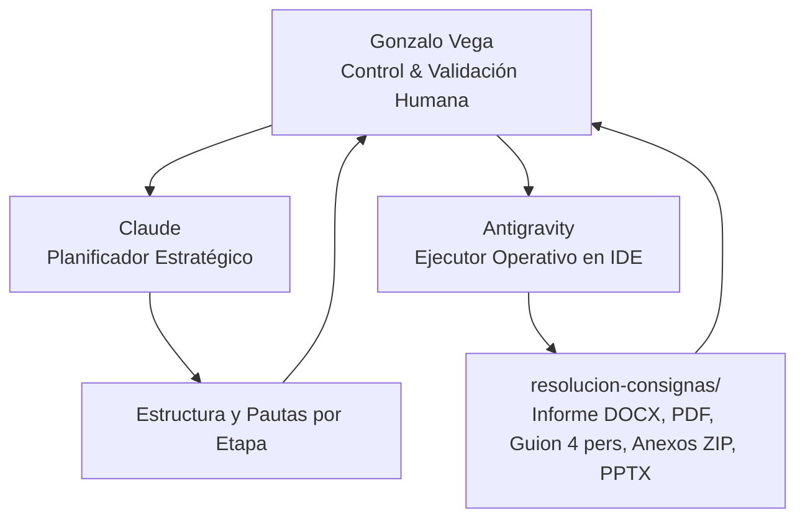

# Guía Maestra para el Modelo de Planeamiento (Claude)

> **Destinatario:** Modelo de Inteligencia Artificial a cargo de la Planificación Estratégica y Arquitectura Dogmática (Claude).  
> **Proyecto:** Trabajo Práctico Integrador (TPI) – Legislación e IA Aplicada (Versión 1.1)  
> **Carrera:** Tecnicatura Universitaria en Programación (UTN)  
> **Estudiante:** Gonzalo Vega  
> **Eje Temático:** **Eje 1 – Cibercrimen, evidencia digital y cadena de custodia**  
> **Caso Seleccionado:** **Caso Ezequiel Nuñes Pinheiro (SIM Swapping, Acceso Ilegítimo a Bases de Datos y Fraude Informático)**  
> **Plantilla Oficial de Entrega:** `material/Plantilla entrega de trabajos ok.docx`  
> **Ubicación de Entregables:** `resolucion-consignas/`  
> **Agente Ejecutor / Operativo:** Antigravity (asistente local en IDE)

---

## 1. Misión de Claude (Planificador) y Orquestación con Antigravity (Ejecutor)

El estudiante ha establecido un flujo en dos capas para garantizar máxima rigurosidad técnica y jurídica:

* **Rol de Claude:**
  1. Diseñar la arquitectura conceptual del informe respetando las 6 etapas obligatorias.
  2. Determinar la subsunción dogmático-penal exacta del caso bajo el Código Penal Argentino (Ley 26.388).
  3. Definir la matriz de riesgos formal (al menos 5 riesgos con tipificación, norma, probabilidad, impacto y mitigación).
  4. Proveer las directrices técnicas para el protocolo de cadena de custodia (ISO/IEC 27037) y la plantilla del informe técnico-pericial del TUP.
  5. Pautar la división de roles para el guion de exposición de 4 integrantes (8 a 12 minutos).

* **Rol de Antigravity:**
  1. Redactar y maquetar el informe final en formato Word (`.docx`) sobre `material/Plantilla entrega de trabajos ok.docx` y compilarlo en PDF.
  2. Redactar el guion completo de la presentación para 4 integrantes en `resolucion-consignas/presentacion-y-guion/guion-video-presentacion-4-integrantes.md`.
  3. Poblar la presentación editable en `resolucion-consignas/presentacion-y-guion/`.
  4. Generar todos los archivos que integran la carpeta `resolucion-consignas/anexos-para-zip/` (informe pericial, formulario de cadena de custodia, script Python de verificación de hashes, matriz detallada y registros de IA).

---

## 2. Ficha Técnica y Fáctica del Caso: Ezequiel Nuñes Pinheiro

* **Contexto geográfico y temporal:** Eldorado (Provincia de Misiones) y Ciudad Autónoma de Buenos Aires (2022 - 2023).
* **Los Hechos Investigados:**
  * El imputado desplegó ataques dirigidos de **SIM Swapping** (suplantación de identidad ante las empresas prestadoras de telefonía móvil, como Telecom/Personal) para solicitar la reposición fraudulenta y duplicación no autorizada de tarjetas SIM pertenecientes a las víctimas (magistrados de la Corte Suprema, jueces federales, funcionarios públicos y particulares).
  * Como fase previa y concurrente, ejecutó **accesos ilegítimos y consultas masivas no autorizadas a bases de datos de información crediticia y datos personales (Nosis, Veraz, Renaper)** para sortear los cuestionarios de validación de identidad requeridos por las operadoras telefónicas (fechas de emisión de DNI, números de trámite, domicilios previos).
  * Una vez activada la SIM duplicada en su poder, interceptó en tiempo real los códigos OTP remitidos por SMS para vulnerar el **Doble Factor de Autenticación (2FA)** y restablecer contraseñas, tomando el control exclusivo de cuentas de mensajería instantánea (**Telegram y WhatsApp**) y correos electrónicos de las víctimas.
  * Se constató la posterior exfiltración, difusión no consentida de información privada y maniobras extorsivas y de suplantación.
* **Intervención Judicial y Pericial:**
  * Investigación coordinada por la Unidad Fiscal Especializada en Delitos y Contravenciones Informáticas de CABA (**UFEDECO**, Dr. Alejandro Musso) y la **UFECI** (Dr. Horacio Azzolin).
  * Allanamiento en Eldorado (Misiones) con secuestro de 15 tarjetas SIM, teléfonos móviles, notebooks, memorias flash y routers.
  * Análisis pericial sobre **logs de conexión de servidores web con registros IP**, registros de detalle de llamadas (CDR - Call Detail Records), celdas de antenas de telecomunicaciones (BTS) y extracciones forenses lógicas y físicas de dispositivos móviles utilizando *Cellebrite UFED* con cálculo de **hashes criptográficos SHA-256**.
* **Resolución Judicial y Certeza Procesal:**
  * **Sentencia condenatoria firme en Juicio Abreviado** homologada el **6 de octubre de 2023** por la Jueza María Araceli Martínez, titular del Juzgado de 1ª Instancia en lo Penal, Contravencional y de Faltas N° 29 de CABA.
  * Condena a **3 años de prisión en suspenso** tras confesar los hechos, decomiso judicial definitivo de todo el hardware secuestrado y sujeción a estrictas reglas de conducta.

---

## 3. Requerimientos Normativos y Estructura del Informe (6 Etapas)

Claude debe estructurar el contenido garantizando la satisfacción de los criterios de la rúbrica UTN:

1. **Portada:** Basada en la plantilla de Gonzalo Vega (`material/Plantilla entrega de trabajos ok.docx`).
2. **Resumen Ejecutivo:** Estrictamente de **8 a 12 líneas** (síntesis del caso, vector técnico, tipificación penal y conclusión pericial).
3. **Etapa 1 – Presentación del caso y alcance:**
   * Actores: Imputado (Nuñes Pinheiro), víctimas (jueces, funcionarios, particulares), operadoras (Telecom/Personal), proveedores de datos (Nosis/Renaper), fiscalías especializadas (UFEDECO, UFECI).
   * Sistema analizado: Ecosistema celular (red GSM/LTE, protocolo SS7, SMS OTP), sistemas de provisión de SIM (operadoras telefónicas), bases de datos Nosis/Renaper y aplicaciones de mensajería (Telegram/WhatsApp).
   * Datos tratados y alcance pericial: Registros de logs, direcciones IP, celdas BTS, volcados forenses de memoria y copias espejo.
4. **Etapa 2 – Marco jurídico aplicable (con fundamentación de aplicabilidad):**
   * **Código Penal de la Nación Argentina (Ley 26.388 de Delitos Informáticos):**
     * **Art. 153 bis CPA:** Acceso no autorizado a sistemas informáticos de acceso restringido (consultas ilegítimas a Nosis/Renaper y secuestro de cuentas).
     * **Art. 173 inc. 16 CPA:** Defraudación mediante técnicas de manipulación informática o uso no autorizado de datos.
     * **Art. 157 CPA:** Violación de secretos y revelación indebida de datos personales.
   * **Ley 25.326 de Protección de los Datos Personales:** Deber de seguridad (art. 9), deber de confidencialidad (art. 10) y responsabilidad de los bancos de datos.
   * **Estándar Internacional ISO/IEC 27037:** Directrices para el aseguramiento, identificación, recolección, adquisición y preservación de evidencia digital.
   * **RFC 3227:** Orden de volatilidad de la evidencia digital.
   * **Convenio de Budapest sobre Ciberdelincuencia (Ley 27.411):** Conservación rápida de datos informáticos almacenados y auxilio judicial.
5. **Etapa 3 – Matriz de riesgos legales y de cumplimiento (mínimo 5 riesgos):**
   * Formato obligatorio de tabla:  
     `| Riesgo | Tipo | Norma/Principio Vinculado | Probabilidad | Impacto | Medida Propuesta |`
   * Debe abarcar riesgos: Penales (imputación por arts. 153 bis y 173 inc. 16), Procesales (nulidad de evidencia por quiebre de cadena de custodia - art. 18 CN), Administrativos/Regulatorios (sanciones del ENACOM y AAIP por vulneración en portabilidad y custodia de datos), Técnicos (vulnerabilidad intrínseca del 2FA vía SMS no cifrado) y Reputacionales.
6. **Etapa 4 – Medidas, documentos y protocolos propuestos:**
   * Procedimiento de adquisición forense bit a bit (imágenes `raw`/`dd` o `E01`) y cálculo de hashes SHA-256.
   * Formulario modelo de **Cadena de Custodia** conforme a ISO/IEC 27037.
   * **Plantilla de Informe Técnico-Jurídico** emitido por el Técnico Universitario en Programación (TUP) actuando como consultor pericial.
   * Propuestas técnicas de mitigación: abandono de 2FA vía SMS a favor de llaves de seguridad FIDO2/WebAuthn o TOTP (RFC 6238), y validación biométrica obligatoria en reemplazo de preguntas de seguridad estáticas ante trámites de reemplazo de SIM.
7. **Etapa 5 – Uso de IA y reflexión crítica:**
   * Detalle de herramientas (Claude para arquitectura, Antigravity para ejecución). Declaración explícita de trazabilidad remitiendo a los anexos en `actividad-IA/`.
8. **Etapa 6 – Conclusiones y rol profesional del TUP:**
   * Responsabilidad legal y deontológica del programador, límites del perito técnico y valor probatorio en la justicia penal.
9. **Bibliografía y fuentes jurisprudenciales.**

---

## 4. Distribución del Guion de Exposición para 4 Integrantes (8 a 12 minutos)

El guion para el punto 6.3 debe estructurarse con tiempos exactos:

| Integrante | Rol Temático | Secciones Asignadas | Tiempo Estimado |
|:---|:---|:---|:---|
| **Integrante 1** | **Apertura y Hechos** | Portada, resumen ejecutivo, presentación del caso Nuñes Pinheiro, vector de ataque (SIM Swapping) y alcance técnico. | 2:30 min |
| **Integrante 2** | **Marco Jurídico Penal** | Ley 26.388 (arts. 153 bis, 173 inc. 16, 157 CPA), Ley 25.326, Convenio de Budapest y garantías procesales (art. 18 CN). | 2:30 min |
| **Integrante 3** | **Matriz de Riesgos y Medidas** | Exposición de la matriz de riesgos priorizada, falencias de 2FA por SMS y propuestas de mitigación técnica y regulatoria. | 2:30 min |
| **Integrante 4** | **Cadena de Custodia e IA** | Procedimiento forense (ISO 27037, hashes SHA-256, logs), rol del TUP, declaración de IA y conclusiones finales. | 2:30 min |
| **TOTAL** | | | **10:00 min** (dentro del rango 8-12 min) |

---

## 5. Instrucciones para la Salida de Claude
Cuando el usuario te presente esta guía:
* Desarrolla en profundidad y de forma estructurada cada una de las **6 etapas**.
* Aporta los textos, tablas y redacciones técnicas precisas para que Antigravity pueda volcarlas directamente a la plantilla oficial de Word, armar el guion de presentación y compilar los archivos del ZIP de anexos.
