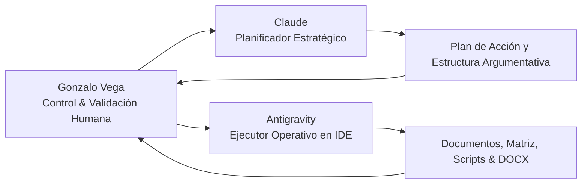

# Guía Maestra para el Modelo de Planeamiento (Claude)

> **Destinatario:** Modelo de Inteligencia Artificial a cargo de la Planificación y Arquitectura de Contenidos (Claude).  
> **Proyecto:** Trabajo Práctico Integrador (TPI) – Legislación e IA Aplicada  
> **Carrera:** Tecnicatura Universitaria en Programación (UTN)  
> **Estudiante:** Gonzalo Vega  
> **Eje Temático:** **Eje 1 – Cibercrimen, evidencia digital y cadena de custodia**  
> **Plantilla Oficial de Entrega:** `material/Plantilla entrega de trabajos ok.docx`  
> **Agente Ejecutor / Operativo:** Antigravity (asistente local en IDE)

---

## 1. División de Roles y Flujo de Trabajo

Para maximizar la calidad académica y la rigurosidad técnica, el trabajo se organiza en un esquema de dos agentes coordinados por el estudiante:

* **Rol de Claude (Planificador Estratégico):**
  * Conceptualizar la estrategia dogmático-penal y el análisis pericial del caso seleccionado.
  * Diseñar la estructura pormenorizada de cada una de las 6 etapas obligatorias del informe.
  * Formular la matriz de riesgos formal (al menos 5 riesgos con tipificación, norma, probabilidad, impacto y mitigación).
  * Redactar las bases del protocolo pericial de cadena de custodia y la plantilla de informe técnico del TUP.
  * Entregar instrucciones claras y modulares para que el agente ejecutor (Antigravity) ensamble los textos y aplique el formato sobre la plantilla oficial.

* **Rol de Antigravity (Ejecutor Operativo):**
  * Interactuar con el sistema de archivos local, auditar fuentes, extraer textos de normas y fallos.
  * Poblar y maquetar el documento final sobre `material/Plantilla entrega de trabajos ok.docx`.
  * Mantener al día la bitácora de trazabilidad `actividad-IA/registro-trazabilidad-ia.md`.
  * Preparar las diapositivas para la presentación final (`Modelo_Presentacion_TPI_Legislacion.pptx`).

---

## 2. Consigna y Requisitos Obligatorios de la Cátedra

El trabajo debe respetar estrictamente la rúbrica de la UTN y estructurarse en **6 Etapas Obligatorias**:

1. **Etapa 1 – Presentación del caso y alcance:**
   * Descripción del escenario fáctico real elegido, actores (víctimas, imputado/s, investigadores, fiscalías), sistema/servicio informático afectado, vectores de ataque, datos comprometidos y límites del análisis pericial.
2. **Etapa 2 – Marco jurídico aplicable:**
   * Tipificación penal argentina (Ley 26.388 que modificó el Código Penal: art. 153 bis -acceso indebido-, arts. 183 y 184 inc. 5/6 -daño informático e interrupción de servicios-, art. 157 -violación de secretos-, etc.).
   * Normativa procesal y protocolos de evidencia digital (Guías del Ministerio Público Fiscal, arts. de allanamiento y secuestro digital).
   * Estándares periciales internacionales (ISO/IEC 27037 para levantamiento y preservación; RFC 3227 para orden de volatilidad).
   * Cooperación internacional y Convenio de Budapest sobre Ciberdelincuencia (Ley 27.411 de adhesión de Argentina).
3. **Etapa 3 – Matriz de riesgos legales y de cumplimiento:**
   * Tabla estructurada obligatoria con al menos 5 riesgos concretos:
     * *Campos requeridos:* `Riesgo` | `Tipo` (Penal, Civil, Administrativo, Técnico, Reputacional) | `Norma/Principio Vinculado` | `Probabilidad` | `Impacto` | `Medida Propuesta`.
4. **Etapa 4 – Medidas, documentos y protocolos:**
   * Procedimiento de relevamiento, preservación y documentación de evidencia digital (adquisición forense bit a bit, cálculo de hashes SHA-256, preservación de logs y sellado de tiempo).
   * Formulario / Protocolo formal de **Cadena de Custodia**.
   * **Plantilla de Informe Técnico-Jurídico** emitido por el Técnico Universitario en Programación (TUP) actuando como consultor técnico o perito de parte.
5. **Etapa 5 – Uso de IA y reflexión crítica:**
   * Declaración explícita de herramientas utilizadas, prompts, resultados aprovechados, descartes y método de validación humana (remitiendo a los anexos de la carpeta `actividad-IA/`).
6. **Etapa 6 – Conclusiones y rol profesional del TUP:**
   * Reflexión ética y técnica sobre las responsabilidades profesionales, el valor probatorio de los sistemas y el límite de las competencias del programador frente a la labor judicial.

---

## 3. Entregables Finales Esperados
* **Portada oficial:** Conforme a `material/Plantilla entrega de trabajos ok.docx` (Alumno: Gonzalo Vega, Materia: Legislación, etc.).
* **Resumen ejecutivo:** Entre 8 y 12 líneas (estricto según consigna).
* **Informe escrito completo:** 6 etapas desarrolladas con rigor técnico-jurídico.
* **Anexos:** Carpeta `actividad-IA` con bitácoras y registros.
* **Presentación:** Guion y diapositivas basadas en `consignas/Modelo_Presentacion_TPI_Legislacion.pptx` (duración estimada para video: 8 a 12 minutos).

---

## 4. Análisis y Selección del Caso para Claude

Al momento de planificar, evalúa la siguiente comparativa crítica:

| Criterio | Caso Vélez Cheratto ("Líbero") *(Recomendado)* | Caso LibreFútbol / Pelota Libre |
|:---|:---|:---|
| **Alineación con el Eje** | **100% Eje 1 (Cibercrimen & Evidencia Digital).** Hackeo, defacement a *El Litoral*, interrupción de servicios, intrusión al Ministerio de Seguridad y amenazas. | **Eje 3 (Propiedad Intelectual).** Retransmisión de señales audiovisuales y elusión de tokens bajo la Ley 11.723. |
| **Certeza Judicial / Sentencia** | **Sentencia firme y condenatoria** (Juicio abreviado ante Tribunal Oral Federal) + Fallo de Casación Penal Sala I (Causa 19631/Reg. 555) sobre custodia de evidencias digitales e informes forenses. | **Sin sentencia definitiva.** Causa reciente (julio 2024), excarcelación del creador ("Kashgar") y suspensión del proceso o investigación preliminar abierta. |
| **Presencia en la Cátedra** | **Caso insignia de la Unidad 4** de la propia materia Legislación (referenciado explícitamente en el material provisto por el alumno). | Caso mediático reciente, pero ajeno al núcleo de delitos informáticos puros de la Ley 26.388. |
| **Riqueza de Evidencia Digital** | Análisis de logs de servidores web, direccionamiento IP, allanamientos informáticos, copias espejo de discos, hashes y custodia de soportes ópticos/magnéticos. | Principalmente dominios DNS, stream grabbing y convenios de piratería comercial. |

---

## 5. Directrices de Salida para Claude
Cuando el usuario te solicite planificar una etapa o el trabajo completo:
1. **Sé preciso y modular:** Divide las propuestas en secciones claras que Antigravity pueda transformar en archivos o código.
2. **Cita las normas con exactitud:** Usa la numeración real del Código Penal Argentino tras la reforma de la Ley 26.388 y la Ley 25.326.
3. **Fundamenta la técnica:** En los puntos periciales, detalla comandos, herramientas estándar (ej. `dd`, `dcfldd`, `sha256sum`, Autopsy, FTK Imager) y metodologías formales reconocidas.
4. **Respeta la rúbrica:** Asegúrate de que no quede ningún criterio evaluativo sin cubrir.
